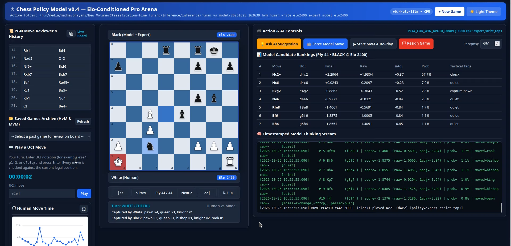
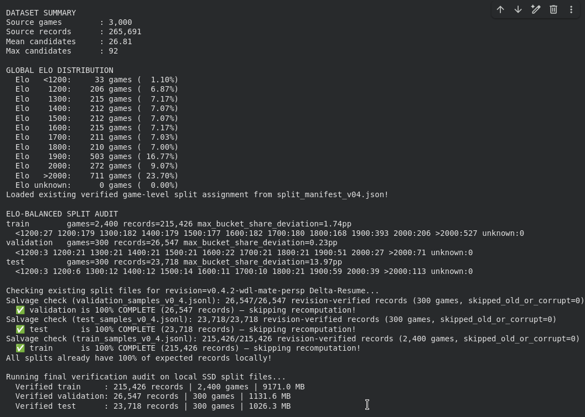
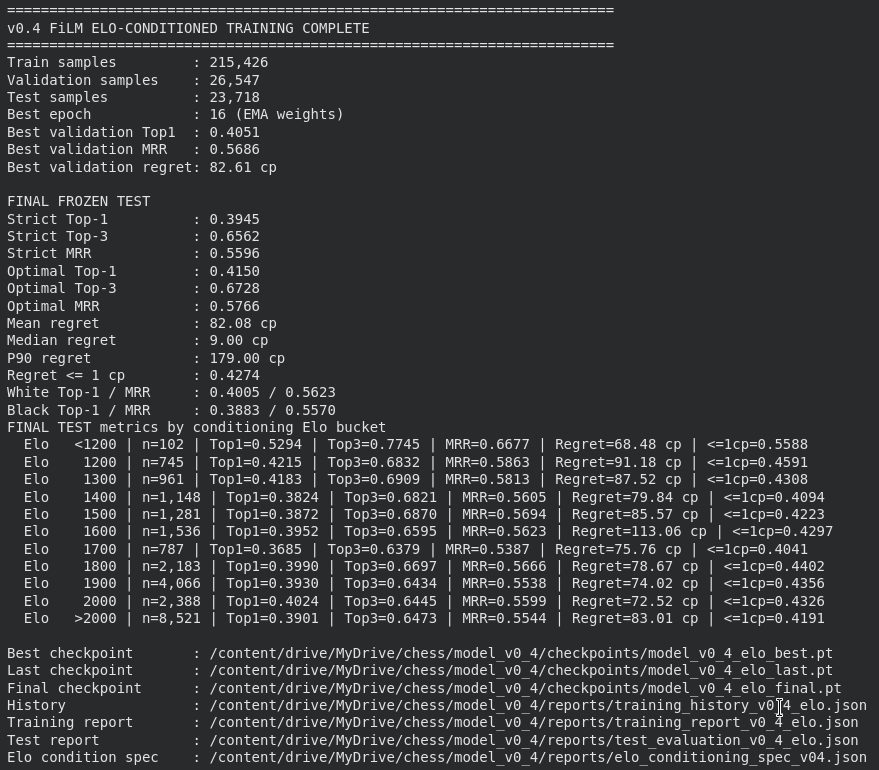
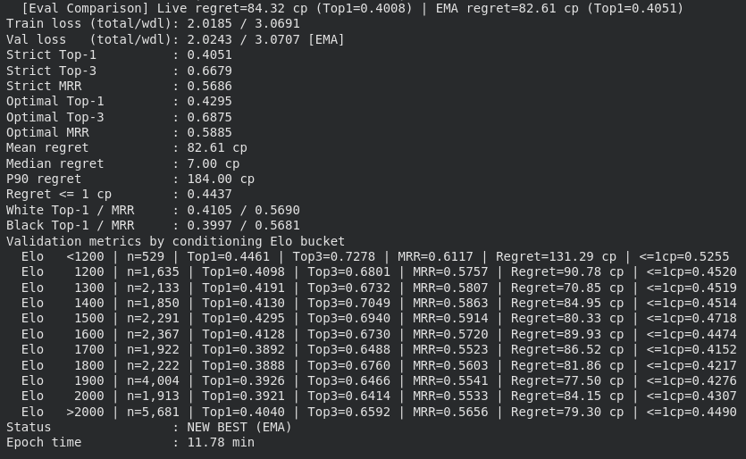
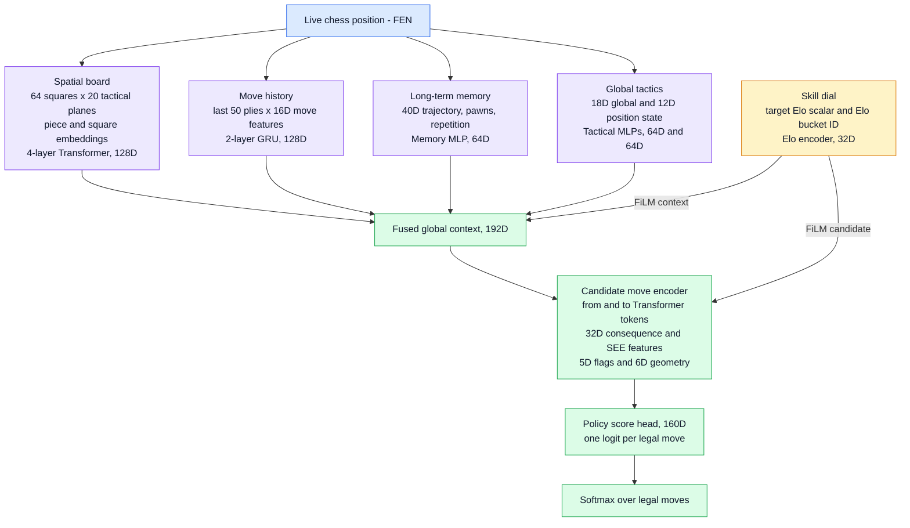

<div align="center">

<h1>♔ PlayChess v0.4</h1>
<h3>Elo-Conditioned Neural Chess Policy Network</h3>

<p>
A ~0.9M-parameter <b>contextual listwise policy ranker</b> built in PyTorch.<br />
It scores every legal move in a single forward pass and adapts its strength to a target Elo (1200 – 2200+).
</p>

[](https://pytorch.org/)
[](https://www.python.org/)
[](https://huggingface.co/madhavbhayani/playchess/tree/main)
[](https://huggingface.co/datasets/madhavbhayani/playchess-3000Games/tree/main)
[](LICENSE)

<br />

<a href="https://raw.githubusercontent.com/madhavbhayani/PlayChess/main/Images%20and%20Videos/PlayChess.png" target="_blank">
  
</a>

<sub>Click any image to open it full-size.</sub>

</div>

---

## 📑 Table of Contents

- [Overview](#-overview)
- [Highlights](#-highlights)
- [Visual Gallery](#️-visual-gallery)
- [Model Architecture](#-model-architecture)
- [Performance & Evaluation](#-performance--evaluation)
- [Dataset & Elo Conditioning](#️-dataset--elo-conditioning)
- [Pre-Trained Checkpoints](#-pre-trained-checkpoints)
- [Quick Start](#-quick-start)
- [1. Generating the Dataset](#-1-generating-the-dataset)
- [2. Training Notebook](#-2-training-notebook)
- [3. Inference & Web Arena](#-3-inference--web-arena)
- [Limitations](#️-limitations)
- [Roadmap](#️-roadmap)
- [Contributing](#-contributing)
- [Citation](#-citation)
- [Acknowledgements](#-acknowledgements)
- [Author](#-author)

---

## 🌟 Overview

**PlayChess** is an end-to-end neural chess decision-making system trained from scratch in **PyTorch**.

Traditional engines such as Stockfish search millions of nodes per second. PlayChess takes a different route: it is a **Contextual Listwise Policy Ranker** that reads a board position, scores **100% of the legal candidate moves in one forward pass**, and returns a probability distribution over them.

Two ideas make it adaptive:

- **Dual-Stream FiLM Elo Conditioning** — a target rating modulates both the board context and every candidate move (Feature-wise Linear Modulation).
- **Exchange-Aware SEE Refinement** — Static Exchange Evaluation features teach the model which captures and landing squares are tactically safe.

The repository also ships a full-width **Web Chess Arena** with a live **2200-Elo AI Coach**.

## ✨ Highlights

| | Feature | Details |
| :-: | :-- | :-- |
| 🎚️ | **Elo-adaptive play** | One model, any strength from 1200 to 2200+ via a skill dial |
| ⚡ | **Single-pass ranking** | All legal moves scored in parallel, with no tree search required in the base policy |
| 🛡️ | **Tactical awareness** | SEE-based consequence features reduce free piece losses |
| 🧪 | **Leak-free evaluation** | Game-level, opening-grouped, Elo-stratified 80/10/10 split |
| 🌐 | **Interactive Web Arena** | Human vs. Model, Model vs. Model, AI Coach, PGN scrubber, saved-game archive |
| 📦 | **Ready-to-use weights** | Hosted on [Hugging Face](https://huggingface.co/madhavbhayani/playchess/tree/main) |
| 📚 | **Open dataset** | 3,000 Stockfish-labelled games on [Hugging Face Datasets](https://huggingface.co/datasets/madhavbhayani/playchess-3000Games/tree/main) |

---

## 🖼️ Visual Gallery

<table>
  <tr>
    <td align="center" width="50%">
      <a href="https://raw.githubusercontent.com/madhavbhayani/PlayChess/main/Images%20and%20Videos/PlayChess.png" target="_blank">
        
      </a>
      <br />
      <b>🌐 Interactive Web Arena</b><br />
      <sub>Human vs. Model, AI Coach and PGN scrubber</sub>
    </td>
    <td align="center" width="50%">
      <a href="https://raw.githubusercontent.com/madhavbhayani/PlayChess/main/Images%20and%20Videos/DataSet%20Split.png" target="_blank">
        
      </a>
      <br />
      <b>📊 Dataset Split</b><br />
      <sub>Game-level, Elo-stratified 80 / 10 / 10</sub>
    </td>
  </tr>
  <tr>
    <td align="center" width="50%">
      <a href="https://raw.githubusercontent.com/madhavbhayani/PlayChess/main/Images%20and%20Videos/Final%20Metrics.png" target="_blank">
        
      </a>
      <br />
      <b>🏆 Final Frozen Test Metrics</b>
    </td>
    <td align="center" width="50%">
      <a href="https://raw.githubusercontent.com/madhavbhayani/PlayChess/main/Images%20and%20Videos/Eponch%2016%20Metrics.png" target="_blank">
        
      </a>
      <br />
      <b>📈 Epoch 16 Convergence</b><br />
      <sub>Training and validation</sub>
    </td>
  </tr>
</table>

---

## 🧠 Model Architecture

PlayChess (`ChessPolicyRankerV04Elo`, ~0.9M parameters) processes **five contextual streams**, fuses them into a global context, then scores each legal move with Elo-modulated features.



<details>
<summary><b>Plain-text version of the diagram</b> (for viewers without Mermaid support)</summary>

```text
                    LIVE CHESS POSITION (FEN)
                               |
   +------------+------------+-+----------+-------------+
   |            |            |            |             |
1. SPATIAL   2. HISTORY   3. MEMORY   4. GLOBAL      5. SKILL DIAL
64x20 planes 50 plies x   40D traj.,  18D global +   Target Elo +
4-layer      16D feats,   pawns,      12D position    Elo bucket ID
Transformer  2-layer GRU  repetition  state, MLPs     Elo encoder
(128D)       (128D)       MLP (64D)   (64D + 64D)     (32D)
   |            |            |            |             |
   +------------+-----+------+------------+             |
                      v                                 |
          192D FUSED GLOBAL CONTEXT <---- FiLM (ctx) ---+
                      |                                 |
                      v                                 |
              CANDIDATE MOVE ENCODER <--- FiLM (cand) --+
        from/to tokens + 32D consequence/SEE
        + 5D flags + 6D geometry
                      |
                      v
           POLICY SCORE HEAD (160D)
        1 logit per legal move -> softmax
```

</details>

---

## 📈 Performance & Evaluation

Results come from the **frozen test set** evaluation of `model_v0_4_elo_final.pt`. All labels are Stockfish **depth-12 Multi-PV** evaluations of every legal move.

### 🎯 Test-Set Metrics

| Metric | Value | What it means |
| :-- | :-: | :-- |
| **Strict Top-1 accuracy** | **39.4%** | The model picked Stockfish's exact #1 move in roughly 4 of every 10 positions. |
| **Strict Top-3 accuracy** | **65.6%** | The engine's #1 move was in the model's top 3 about two-thirds of the time. |
| **Optimal Top-1 / Top-3** | **55.8% / 77.8%** | When several moves are equally good, the model's first choice was optimal over half the time, and one of its top 3 was optimal over 77% of the time. |
| **Mean regret** | **80.1 cp** | Averaged over all test positions, the chosen move was about 0.80 pawns worse than the engine's best. |
| **Zero-regret rate (≤ 1 cp)** | **42.7%** | In about 43% of positions the chosen move was equal to, or within 0.01 pawns of, the best. |

> **Glossary.** *Regret* is the centipawn (cp) loss versus the engine's best move. *Strict* accuracy needs the exact engine move; *optimal* accuracy accepts any move tied for best.

### ♟️ In Plain English

1. **It adjusts to your level.** At 1200 Elo it plays softer, more human-like moves that leave room for tactics. At 2200 it sharpens, prioritising checkmates, piece safety and precision.
2. **It has a built-in safety check.** SEE-based features help it notice when a piece would land on a square where it can be captured for free, so even at lower levels it tends to avoid giving pieces away outright.
3. **It suggests human-plausible moves.** The AI Coach favours sensible, tournament-style moves over purely engine-driven lines, which makes its advice practical to learn from.

> 📌 Playing strength depends on the selected Elo, the difficulty mode (see [Web Arena](#-3-inference--web-arena)) and the optional 1–2 ply lookahead. Numbers above describe the **raw policy** on held-out positions, not match results against engines or humans.

---

## 🗂️ Dataset & Elo Conditioning

### 📥 Download the Dataset

The full **3,000-game dataset** (every legal move at every ply labelled with Stockfish depth-12 Multi-PV) is hosted on Hugging Face:

**👉 [`madhavbhayani/playchess-3000Games`](https://huggingface.co/datasets/madhavbhayani/playchess-3000Games/tree/main)**

```bash
pip install -U huggingface_hub

huggingface-cli download madhavbhayani/playchess-3000Games \
    --repo-type dataset \
    --local-dir Datasets/playchess-3000Games
```

Or from Python:

```python
from huggingface_hub import snapshot_download

snapshot_download(
    repo_id="madhavbhayani/playchess-3000Games",
    repo_type="dataset",
    local_dir="Datasets/playchess-3000Games",
)
```

You can feed the downloaded `.jsonl` straight into **Script 1** (the validator) of the [training notebook](#-2-training-notebook), so there is no need to regenerate it unless you want a larger or different dataset.

### Zero-Leakage Splitting (Script 2)

The split is made at the **game level**, not the position level. Mixing positions from one game across train and test would let the model memorise games instead of learning chess.

1. **Opening-signature grouping.** Games are grouped by their first 8 plies, so related opening lines stay in the same split.
2. **Elo-balanced stratification.** Each group is assigned to **Train (80%)**, **Validation (10%)** or **Test (10%)** so that every split has the same Elo distribution as the full dataset.

### 📊 Elo Distribution (3,000 games, 260K+ positions)

Taken from the Script 3 preflight validation:

| Elo bucket | Games | Share | Tier |
| :-: | :-: | :-: | :-- |
| < 1200 | 33 | 1.10% | Beginner |
| 1200 | 206 | 6.87% | Novice |
| 1300 | 215 | 7.17% | Advanced beginner |
| 1400 | 212 | 7.07% | Lower club |
| 1500 | 212 | 7.07% | Intermediate club |
| 1600 | 215 | 7.17% | Solid club |
| 1700 | 211 | 7.03% | Strong club |
| 1800 | 210 | 7.00% | Candidate expert |
| 1900 | 503 | 16.77% | Expert |
| 2000 | 272 | 9.07% | Candidate master |
| > 2000 | 711 | 23.70% | Master and above |
| **Total** | **3,000** | **100%** | |

### ⚙️ How Elo Modulates the Model

1. **Dual-stream FiLM.** The target Elo scales and shifts activations in both the **board context** and the **candidate-move** encoders.
2. **Elo-dependent teacher temperature.** Training targets are softened according to the target rating:

$$
T(\mathrm{Elo}) = 90 - 0.03\,(E - 1200) - 0.0625\,\max(0,\,E - 1800), \qquad E = \mathrm{clamp}(\mathrm{Elo},\,1200,\,2200)
$$

| Target Elo | Temperature | Behaviour |
| :-: | :-: | :-- |
| 1200 | 90 cp | Soft distribution, with natural and occasionally imperfect choices |
| 1800 | 60 cp | Mid-range sharpening |
| 2200 | 35 cp | Sharp distribution, close to engine precision |

<details>
<summary>Same formula in plain text</summary>

```text
E = clamp(Elo, 1200, 2200)
T = 90 - 0.03 * (E - 1200) - 0.0625 * max(0, E - 1800)
```

</details>

---

## 📦 Pre-Trained Checkpoints

All checkpoints live on Hugging Face: **[`madhavbhayani/playchess`](https://huggingface.co/madhavbhayani/playchess/tree/main)**.

| Checkpoint | Stage | Contents | Use it for |
| :-- | :-- | :-- | :-- |
| `model_v0_4_initial.pt` | Script 3 (pre-training) | Freshly initialised `ChessPolicyRankerV04` weights, saved after the dataset preflight audit and a forward-pass smoke test | Sanity checks and debugging training loops |
| `model_v0_4_elo_best.pt` | Script 4 (best validation) | Best of **live** vs. **EMA shadow** weights, chosen by lowest validation `regret_cp` | Playing, coaching and validation benchmarks |
| `model_v0_4_elo_last.pt` | Script 4 (latest epoch) | Live weights, EMA state, optimizer state and LR-scheduler state | Resuming interrupted training |
| **`model_v0_4_elo_final.pt`** | Script 4 (release) | Same weights as `best`, bundled with the **frozen test report** (`final_test_metrics`), the Elo-conditioning spec and training history | **Recommended default** for `inference.py` and the Web Arena |

---

## ⚡ Quick Start

```bash
# 1. Clone
git clone https://github.com/madhavbhayani/PlayChess.git
cd PlayChess

# 2. Install dependencies (adjust to your requirements.txt if you have one)
pip install torch python-chess

# 3. Download the production checkpoint
mkdir -p checkpoints
wget https://huggingface.co/madhavbhayani/playchess/resolve/main/model_v0_4_elo_final.pt \
     -O checkpoints/model_v0_4_elo_final.pt

# 4. Launch the Web Arena (choose "2 = Local PC" when prompted)
python inference.py
```

> Want to train or validate yourself? Grab the dataset from [Hugging Face](https://huggingface.co/datasets/madhavbhayani/playchess-3000Games/tree/main) and see the [training notebook](#-2-training-notebook).

Then open **http://127.0.0.1:7860** in your browser.

---

## 🚀 1. Generating the Dataset

> 💡 **Want to skip generation?** Download the finished 3,000-game dataset from [Hugging Face](https://huggingface.co/datasets/madhavbhayani/playchess-3000Games/tree/main) (see [Download the Dataset](#-download-the-dataset)). Generating it from scratch takes a long time because of the depth-12 Stockfish labelling.

`generate_dataset.py` streams a compressed Lichess archive (`.pgn.zst`), selects novel games across Elo buckets with **deficit-aware water-filling**, and labels every legal move at every ply with **Stockfish depth-12 Multi-PV**.

### Step 1 — Download data and Stockfish

```bash
mkdir -p Datasets
wget https://database.lichess.org/standard/lichess_db_standard_rated_2017-09.pgn.zst -P Datasets/

sudo apt-get update && sudo apt-get install -y stockfish
```

### Step 2 — Run generation

```bash
python generate_dataset.py \
  --pgn Datasets/lichess_db_standard_rated_2017-09.pgn.zst \
  --output chess_dataset_v2_3000games_v21.jsonl \
  --games 3000 \
  --elo-min 1200 --elo-max 2000 --elo-step 100 \
  --balance-mode deficit \
  --max-elo-diff 150 \
  --min-plies 24 \
  --novelty-pool-factor 6 \
  --novelty-probe-depth 5 \
  --novelty-probe-positions 5 \
  --novelty-workers 2 \
  --novelty-threads-per-engine 1 \
  --novelty-hash-mb 64 \
  --depth 12 \
  --workers 2 \
  --threads-per-engine 1 \
  --hash-mb 128 \
  --status-interval 30 \
  --scan-log-interval-games 5000 \
  --scan-log-interval-seconds 10 \
  --probe-log-every 5 \
  --selection-log-every 10 \
  --fsync-every-game
```

> The output filename here says `3000games` to match `--games 3000`. Rename it freely, as it is only a path.

### CLI Reference

| Argument | Default | Description |
| :-- | :-: | :-- |
| `--pgn` | *required* | Source Lichess `.pgn.zst` archive from [database.lichess.org](https://database.lichess.org/). |
| `--output` | *required* | Output `.jsonl` path. If it already exists, completed games are kept as an immutable seed and only the missing games are generated. |
| `--games` | *required* | Target total number of unique games in the final dataset. |
| `--elo-min` / `--elo-max` | `1200` / `2000` | Lowest and highest Elo bucket centres to sample. |
| `--elo-step` | `100` | Rating step between buckets (1200, 1300, … 2000). |
| `--balance-mode` | `deficit` | `deficit` fills under-represented buckets first; `uniform` splits the new quota equally. |
| `--max-elo-diff` | `150` | Maximum &#124;WhiteElo − BlackElo&#124;, so both players genuinely belong to the bucket. |
| `--min-plies` | `24` | Minimum game length in plies, filtering early aborts and short resignations. |
| `--allow-time-forfeit` | `False` | By default only `Normal` terminations are used (checkmate, resignation, stalemate, threefold). Pass this to allow time forfeits. |
| `--novelty-pool-factor` | `6` | Candidate pool multiplier per active Elo bucket in Phase 1 (PGN scan). |
| `--novelty-probe-depth` | `5` | Shallow Stockfish depth used in Phase 2 to score candidate-game novelty. |
| `--novelty-probe-positions` | `5` | Evenly spaced positions probed per candidate game in Phase 2. |
| `--novelty-workers` | `1` | Parallel Stockfish processes for Phase 2 probing. |
| `--depth` | `12` | Multi-PV search depth used to label every legal move. |
| `--nodes` | `None` | Optional node limit per position. |
| `--workers` | `1` | Parallel Stockfish processes for full generation. |
| `--threads-per-engine` | `1` | UCI `Threads` per Stockfish worker. |
| `--hash-mb` | `128` | UCI `Hash` size (MB) per Stockfish worker. |
| `--stockfish` | auto-detected | Path to the Stockfish binary if it is not at `/usr/games/stockfish` or on `PATH`. |
| `--status-interval` | `30` | Seconds between progress checkpoints (`.status.json`, `.progress.jsonl`). |
| `--fsync-every-game` | `False` | Calls `os.fsync()` after every finished game, so progress survives crashes on cloud or Colab disks. |

Additional logging and novelty-engine flags are listed by `python generate_dataset.py --help`.

---

## 📓 2. Training Notebook

`PlayChess_Split_Training_Colab.ipynb` contains the complete **5-script pipeline**. It stores splits, reports, logs and checkpoints on Google Drive (`/content/drive/MyDrive/chess/model_v0_4`) while staging active data on local NVMe SSD (`/content/chess/model_v0_4/data`).

| Script | Purpose |
| :-: | :-- |
| **1 / 5** | **Dataset validator.** Multi-core streaming check of the JSONL schema (`2.1` / `v0.4-ready`), SHA-256 checksums, serialized-FEN en-passant semantics, and Level 2 WDL and Mate-in-N coverage. |
| **2 / 5** | **Game-level, Elo-aware split and feature engineering.** Zero-leakage 80/10/10 split, `v0.4` feature tensors, and Drive sync in FUSE-safe 64 MB `fsync` chunks. |
| **3 / 5** | **Preflight audit and model definition.** Verifies cross-split separation, caches byte offsets for O(1) DataLoader seeking, defines `ChessPolicyRankerV04`, and saves `model_v0_4_initial.pt`. |
| **4 / 5** | **12 GB GPU turbo training.** Trains `ChessPolicyRankerV04Elo` with dual-stream FiLM and EMA weights, using 512-sample GPU super-batches (32-sample micro-batches), smooth mate-aware centipawn normalisation, exchange-aware SEE refinement and an Elo-scaled teacher temperature. |
| **5 / 5** | **Inference and Web Arena.** Launches the interactive UI and REST API on Colab or locally. |

---

## 🎮 3. Inference & Web Arena

`inference.py` is standalone and runs on **Google Colab** or a **local PC**.

### Download weights

```bash
# Option A: wget
mkdir -p checkpoints
wget https://huggingface.co/madhavbhayani/playchess/resolve/main/model_v0_4_elo_final.pt \
     -O checkpoints/model_v0_4_elo_final.pt

# Option B: Hugging Face CLI
pip install -U huggingface_hub
huggingface-cli download madhavbhayani/playchess model_v0_4_elo_final.pt --local-dir checkpoints
```

### Launch

```bash
python inference.py
```

| Mode | Behaviour |
| :-: | :-- |
| **1 – Google Colab** *(default)* | Mounts Google Drive, caches the checkpoint locally and prints a clickable proxy URL for the Web Arena. |
| **2 – Local PC** | Scans `./`, `./checkpoints` and `~/Downloads` for `.pt` files, starts the server at `http://127.0.0.1:7860` and opens the full-width **Pro Chess Arena**. |

### Features

- **Human vs. Model.** Enter your Elo and pick a difficulty:

  | Difficulty | Model Elo | Search style |
  | :-- | :-: | :-- |
  | Easy | your Elo − 200 | 0-ply, human-like |
  | Medium | your Elo | 1-ply club guard |
  | Hard | your Elo + 200 | 2-ply tactical minimax |
  | Expert | max(2000, your Elo + 350) | deeper 2-ply minimax with endgame push |

- **Model vs. Model.** Watch two independently configured Elo settings play each other, with adjustable auto-play speed.
- **💡 Live AI Coach.** Request a 2200-Elo suggestion on your turn. The move is highlighted on the board; **Approve & Play** it or **Reject** it, and the next request cycles to the next-best alternative.
- **📜 PGN scrubber and game archive.** Step through any ply (`|<<`, `<`, `>`, `>>|`) to inspect past positions and the model's candidate rankings, or reload finished games from `inference/human_vs_model/` and `inference/model_vs_model/`.

---

## ⚠️ Limitations

- **Small training set.** 3,000 games (~260K positions) is modest, so the model will not match engine-level play and can be inconsistent in rare or deep tactical positions.
- **Stockfish-labelled targets.** Quality is bounded by depth-12 labels, and "human-like" behaviour comes from Elo-conditioned softening of those labels rather than from direct human-move imitation.
- **Offline metrics only.** Top-k accuracy and regret describe held-out positions. Head-to-head results against engines or rated humans are not reported yet.
- **Thin extremes.** Elo buckets below 1200 are sparse (1.1% of games), so behaviour there is less reliable.
- **Rating mapping is heuristic.** The Elo value is a conditioning signal, not a calibrated rating measured on a rating list.

## 🗺️ Roadmap

- [ ] Head-to-head evaluation against Stockfish skill levels and Maia-style baselines
- [ ] Larger dataset (more games, more months of Lichess data)
- [ ] Per-Elo metric breakdown on the test set
- [ ] ONNX export for lightweight deployment
- [ ] Hugging Face Space with a hosted demo
- [ ] `requirements.txt` and a one-command Docker image
- [ ] Demo GIF of the Web Arena in this README

## 🤝 Contributing

Issues and pull requests are welcome. For larger changes, please open an issue first to discuss what you would like to change.

## 📚 Citation

If you use PlayChess in your work, please cite it:

```bibtex
@software{bhayani_playchess_2026,
  author  = {Bhayani, Madhav},
  title   = {PlayChess: An Elo-Conditioned Neural Chess Policy Network},
  year    = {2026},
  version = {0.4},
  url     = {https://github.com/madhavbhayani/PlayChess}
}
```

## 🙏 Acknowledgements

- [Lichess Open Database](https://database.lichess.org/) for the source games (the labelled dataset is on [Hugging Face](https://huggingface.co/datasets/madhavbhayani/playchess-3000Games/tree/main))
- [Stockfish](https://stockfishchess.org/) for move evaluation and labelling
- [python-chess](https://python-chess.readthedocs.io/) for board logic and move generation
- [PyTorch](https://pytorch.org/) and [Hugging Face](https://huggingface.co/) for training and model hosting

## 👤 Author

**Madhav Bhayani**

[](https://github.com/madhavbhayani)
[](https://huggingface.co/madhavbhayani/playchess/tree/main)
[](https://huggingface.co/datasets/madhavbhayani/playchess-3000Games/tree/main)

---

<div align="center">
<sub>If you find PlayChess useful, consider giving the repo a ⭐</sub>
</div>
